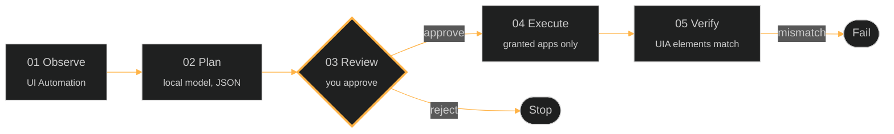

<p align="center">
  
</p>

<p align="center">
  
</p>

<p align="center">
  <a href="https://github.com/oakvx/piko/actions"></a>
  <a href="https://github.com/oakvx/piko/releases"></a>
  
  
  
  
  
</p>

<h3 align="center">An agent that uses your PC like you do, and asks before it touches anything.</h3>

<!-- Uncomment once you have recorded it (ScreenToGif, 10-15s on the testbench), and upload it via an issue or put it in docs/:
<p align="center">
  
</p>
-->

Piko looks at the app in front of it, writes a plan with a local Ollama model, waits for you to read it, and only then clicks and types. No cloud, no background screen stream, no action without your approval.

> [!WARNING]
> **Alpha preview, not a stable release.** CI now verifies Python on Windows/Linux, real WinForms UI Automation, dependency audits and the packaged NSIS install/launch/close/uninstall lifecycle on a hosted Windows Server runner. It **does not** certify clean Windows 10/11 VMs or real Ollama reasoning/vision inference. Do not use Piko for sensitive, destructive or financial tasks.

## How it works



| Step | What happens |
|---|---|
| **Observe** | Reads the foreground window through Windows UI Automation. Screenshots only when you ask. |
| **Plan** | The local model returns a structured JSON plan. |
| **Review** | You read it. Nothing runs until you approve. |
| **Execute** | Actions run only in apps you granted for this session. |
| **Verify** | Piko checks the expected UI elements are there afterwards. |

Cancel any time. Pause takes effect at the next action boundary.

## Quick start

Windows 10/11 x64, Python 3.11–3.13, Ollama, and a local model that can produce structured JSON. A vision model is optional.

```powershell
py -m venv .venv
.\.venv\Scripts\Activate.ps1
pip install -e ".[windows,dev]"
ollama list
piko serve --model YOUR_INSTALLED_MODEL --vision-model YOUR_VISION_MODEL
```

From source, `piko serve` prints a one-time token to paste into the UI. With an installed release the desktop app starts the backend itself and hands over the token through local IPC.

Or grab a build from [Releases](https://github.com/oakvx/piko/releases). Read [Windows installer](#windows-installer) first.

<details>
<summary><b>Desktop UI (Workfield) from source</b></summary>

```sh
cd apps/desktop
npm ci
npm run dev
```

`npm run check` and `npm run build` validate the frontend. `npm run tauri build` also needs Rust, the Microsoft C++ build tools and WebView2. See [Workfield design](docs/architecture/WORKFIELD.md).

The repository includes reviewed npm, Cargo and packaged Python dependency locks. CI uses `npm ci`, locked Rust metadata and a pinned Python Windows backend environment.

</details>

<details>
<summary><b>Try it on a safe target</b></summary>

```powershell
powershell -NoProfile -ExecutionPolicy Bypass -File examples/testbench.ps1
```

Run it in a second terminal, grant Piko access to the testbench only, keep it in the foreground, read the plan, approve. A real Windows WinForms UI Automation smoke test now runs in CI; use the local testbench for additional interactive acceptance.

</details>

## What's in the repo

- Session state machine on SQLite. Sessions interrupted by a restart are marked failed.
- Per-session, per-app permissions and validated UI Automation actions.
- Ollama model discovery, JSON planning, optional screenshot interpretation.
- Consent-based, time-bounded Teach recorder with UIA observations, redacted structural mouse/navigation events and user-corrected draft creation.
- Versioned, importable/exportable draft Skills with rollback, execution history and text-only `{{parameter}}` binding at review time.
- Loopback-only, token-protected API.
- Workfield, the React/Tauri interface.

## Safety

| Rule | |
|---|---|
| No autonomous default | Every run needs an app permission for the session and explicit plan approval. |
| Local inference only | No cloud provider is configured. |
| Screenshots on request | One at a time. No background stream. |
| Credentials blocked | Password-field and credential windows are refused. |
| Loopback API | Not reachable from the network. |

Details: [Security constraints](docs/security/BOUNDARIES.md).

## Known limitations

- Capture uses `mss` on the foreground window, not Windows.Graphics.Capture. A partly covered window can be captured wrong.
- Depends on the accessibility metadata apps expose. No general OCR, no coordinate grounding.
- Teach records approved mouse/navigation events and screenshots but never raw typed characters. Inference is tentative and requires user correction; a successful replay does not automatically certify a Skill.
- Plans are made once, not revised mid-run. Verification needs matching UIA elements.
- Native UIA COM calls already in flight cannot be forcibly killed safely. Emergency stop releases Piko-owned keys and prevents later dispatch after blocked target resolution; a resumed session must revalidate the next action.
- No offline gaming adapter, no live screen streaming, no long autonomous runs.

## Tests

```sh
python -m pip install -e '.[dev]'
python -m pytest -q
python -m compileall -q src tests
```

The portable suite covers contracts, state, permissions, persisted evidence and Skill reuse. Separate Windows CI runs a real WinForms target, foreground-switch denial and installer lifecycle smoke. Actual local Ollama model inference remains an explicit, separately configured acceptance gate.

## Windows installer

Every push and PR builds an NSIS x64 installer with the Python backend bundled. Green builds on `main` are published as prereleases with a SHA-256 checksum.

Each main prerelease requires successful compilation, dependency audits, a Windows UIA smoke and a hosted-Windows NSIS install/launch/sidecar-close/uninstall smoke. These checks do not replace clean Windows 10/11 installation, upgrade, reboot and Ollama E2E validation. Check [Actions](https://github.com/oakvx/piko/actions) and [Releases](https://github.com/oakvx/piko/releases) for what exists, and [Preview releases](docs/development/PREVIEW_RELEASES.md) for how the pipeline works.

## Credits

Orchestration, state machine, Skill schema, UI and mascot were written for Piko. It builds on Python, FastAPI, SQLite, the Ollama API, Windows UI Automation, React and Tauri. No third-party agent framework, prompt pack, mascot or UI template is included.

Design notes: [Architecture](docs/architecture/DECISIONS.md).

<p align="center">
  
</p>
